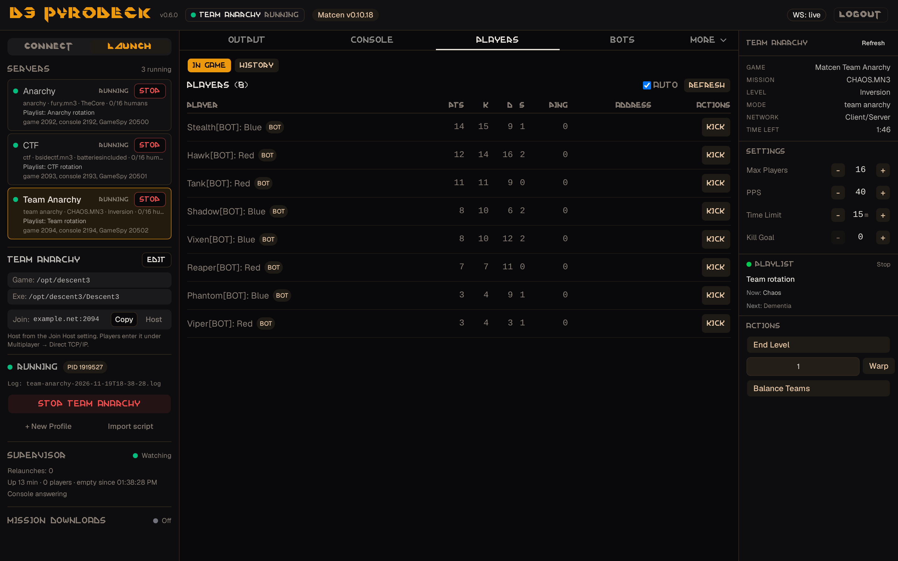
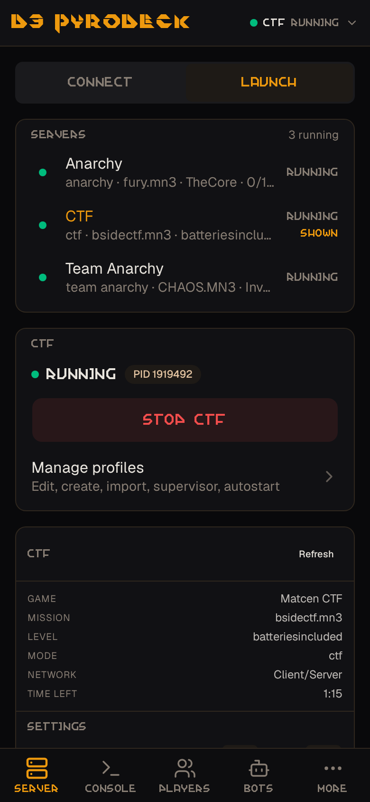
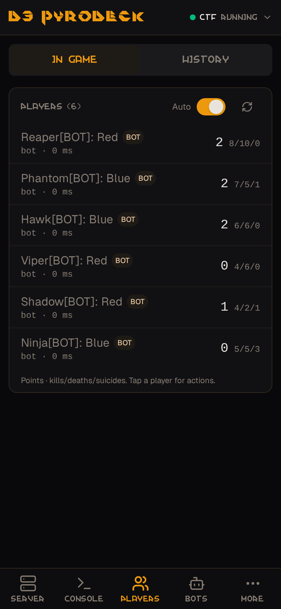
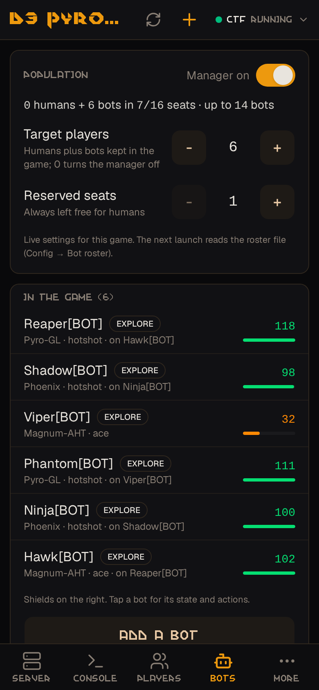

# D3 Pyrodeck

A web admin panel for Descent 3 dedicated servers.

Pyrodeck starts your servers, keeps them running and puts their consoles, players, bots, playlists and logs in a
browser, on a desktop or a phone. One Pyrodeck runs several servers at once. It is the companion to
[Matcen](https://github.com/stev0760/Descent3), the Descent 3 build with multiplayer bots, and also manages servers
without bots.



<p align="center">
  
  
  
</p>

The panel on a desktop and on a phone, running three Matcen servers with bots.

## Features

- **Several servers from one panel.** Each server runs from its own profile, with its own console, supervisor,
  playlist and logs. Start, stop and switch between them from one list.
- **Console and players.** A live console with a command reference, a scoreboard that refreshes itself, kick and ban
  with a reason, and a history of who joined and when.
- **Bots, on a Matcen server.** Add and remove bots, change difficulty and teams, and set how many players the server
  keeps.
- **Playlists.** Rotate a server through a list of missions in order, shuffled or weighted, with an optional player
  vote and a countdown in chat before each change.
- **Mission downloads.** Serve your custom missions to players who join without them.
- **Keeping a server up.** A crashed server is relaunched, a hung one is restarted, an empty one can be restarted
  after an uptime limit, and servers start with Pyrodeck after a reboot. Restarting Pyrodeck does not stop a server.
- **Configuration without editing files.** Forms for the server config, ship and powerup rules, the bot roster and
  startup commands, with a raw editor beside them.
- **Logs.** One log file per launch, viewed or downloaded in the browser, with optional retention and compression.
- **A phone layout.** Below 768 px the panel is a phone app that can be added to the home screen.

[docs/features.md](docs/features.md) describes each of these in detail.

## What it works with

- **Retail Descent 3 1.4 and the [open-source engine](https://github.com/DescentDevelopers/Descent3):** everything
  except the bot features.
- **Matcen:** everything. Pyrodeck asks the server what it supports and shows the bot controls when it answers. A
  current Matcen release is recommended; a server bound to one address with its console kept local needs Matcen
  0.10.8 or later.

Pyrodeck 0.6.0 was tested on Linux: three Matcen 0.10.17 servers on one machine, each on its own playlist, through
several hundred mission changes over more than a day, with Pyrodeck restarted during the run. Earlier versions were
also run by hand on Windows; 0.6.0 itself has not been run on Windows yet.

## Install

1. Download the package for your system from the [Releases page](https://github.com/stev0760/d3-pyrodeck/releases):
   `pyrodeck-<version>-linux-x64.tar.gz` or `pyrodeck-<version>-windows-x64.zip`.
2. Extract it. It holds one program, `pyrodeck-server` (`pyrodeck-server.exe` on Windows), and a `resources` folder
   that must stay beside it. Nothing else needs installing.
3. Run the program from the folder where you want Pyrodeck to keep its settings; it creates a `config` folder there.
4. Open `http://localhost:3001` in a browser on the same machine and choose an admin password.

To check a download, put `SHA256SUMS.txt` from the same release in the same directory, then:

```bash
sha256sum --check --ignore-missing SHA256SUMS.txt        # Linux: "pyrodeck-v0.6.0-linux-x64.tar.gz: OK"
shasum -a 256 --check --ignore-missing SHA256SUMS.txt    # macOS
```

On Windows, in PowerShell, compare the hash with the package's line in `SHA256SUMS.txt`:

```powershell
(Get-FileHash .\pyrodeck-v0.6.0-windows-x64.zip -Algorithm SHA256).Hash.ToLower()
```

A mismatch, or `FAILED`, means the file is not the one the workflow built: download it again, and do not run it.

To build from source instead, see [BUILDING.md](BUILDING.md).

## First server

Pyrodeck needs a Descent 3 installation on the same machine and a `ConsolePassword` in the server's config: it logs
in to each server's console with it.

1. Open the **Launch** tab and point Pyrodeck at your Descent 3 folder.
2. Create a profile, or import the script that used to start your server.
3. Click **Start**. Pyrodeck launches the server and connects to its console on 127.0.0.1, so the config can keep
   `AllowRemoteConsole=0` and the console stays off the network.

To run a second server beside it, see [docs/several-servers.md](docs/several-servers.md).

**Connect mode** is for a server Pyrodeck did not start: enter its host, console port and console password. A server
on another machine needs `AllowRemoteConsole=1` in its config. That console is plain TCP with the password in clear,
so keep its port closed in the firewall to everything but the machine Pyrodeck runs on.

Pyrodeck listens on this machine only. To reach the panel from elsewhere, put it behind a reverse proxy with HTTPS:
[docs/behind-a-reverse-proxy.md](docs/behind-a-reverse-proxy.md).

## Documentation

| Page | What it covers |
|---|---|
| [docs/features.md](docs/features.md) | Every part of the panel in detail |
| [docs/several-servers.md](docs/several-servers.md) | A second server: ports, shared game folders, what Pyrodeck refuses to launch, upgrading from 0.5.x |
| [docs/operations.md](docs/operations.md) | Logs, schedules, email alerts, autostart, the supervisor, bans and join rules |
| [docs/playlists.md](docs/playlists.md) | Playlists, the hold before a mission change, hosting mission downloads |
| [docs/configuration.md](docs/configuration.md) | Access to the panel, sessions, and every environment variable |
| [docs/behind-a-reverse-proxy.md](docs/behind-a-reverse-proxy.md) | A public server: nginx, HTTPS, the firewall |
| [docs/running-as-a-service.md](docs/running-as-a-service.md) | Running unattended with systemd, NSSM or Task Scheduler |
| [docs/phone.md](docs/phone.md) | The phone layout and adding the panel to the home screen |
| [docs/d3-dedicated-server-reference.md](docs/d3-dedicated-server-reference.md) | Descent 3 dedicated server switches, settings and console commands |
| [docs/D3SERVER3_AUDIT.md](docs/D3SERVER3_AUDIT.md) | A feature audit of the older D3Server3 tool, which set Pyrodeck's requirements |
| [BUILDING.md](BUILDING.md) | Building and packaging from source |
| [CHANGELOG.md](CHANGELOG.md) | What each release changed |

## Known limitations

- Playlist rotation is **best-effort**: D3 has no native mission rotation, so every transition is a full server stop → config swap → relaunch. Players must manually reconnect after each rotation (D3 clients cannot be told to reconnect), and the restart can occasionally fail. Treat rotation as a convenience feature, not a guaranteed-uptime mechanism
- Connect mode logs in to one remote console at a time; the servers Pyrodeck launches run beside it
- Player history and rules see only what the server prints on its console: team and private chat are invisible, and a player who drops during a level change is recorded as gone two minutes into the next level
- On retail 1.4 and the open-source engine, console text containing `%` is formatted twice by the server itself and can crash it, so a player whose name or chat contains `%` may crash such a server before the nickname rule can kick them. Matcen 0.10.4 and later are not affected
- Bot team choice in the add-bot form appears only when the server advertises `teams` in `$servercaps` and the game has teams; otherwise use the Bot Roster config editor before launch
- After Pyrodeck restarts and re-attaches to a running server, that server's output is no longer captured: the Output tab and its log file stop at the restart (the console still shows what the server prints there)
- A profile with a bind address (`-useip`) and `AllowRemoteConsole=0` works on Matcen 0.10.8 and later, whose console listens on 127.0.0.1. Older engines (retail 1.4, upstream Descent 3, earlier Matcen) put the console on the bind address but accept only 127.0.0.1, so Pyrodeck cannot log in to them; Pyrodeck warns when the profile is saved, at launch and when the login fails
- Login sessions are kept in memory: restarting Pyrodeck (an upgrade, a crash, the service restarting) logs everyone out, and two Pyrodeck instances behind one proxy do not share sessions
- Log retention covers the Log Directory the Logs tab shows and the folder of the last launch's log; logs that an earlier profile wrote next to another executable (with no Log Directory set) are not pruned
- Windows binaries are unsigned; SmartScreen will warn on first run — click **More info → Run anyway**

## Roadmap

Not promises, and in no fixed order:

- One dashboard for all servers, and supervisor settings per server.
- Signed Windows packages.
- A container image.
- Tracker listing settings in the panel.
- Repeating one level of a multi-level mission.
- A light theme.

## About

Pyrodeck was written by Steve V with substantial AI assistance (Claude, by Anthropic). Design, testing and
every release decision are the author's. Bug reports are welcome on the
[issue tracker](https://github.com/stev0760/d3-pyrodeck/issues).

Licensed under the [MIT License](LICENSE), except the three display fonts in
[`packages/client/public/fonts/`](packages/client/public/fonts/). They are The Descent Fonts V1.3 from 1997 and keep
their own terms, stated in `README.TXT` there: non-commercial distribution, with that file included. `CHANGES.TXT`
beside it records the one repair made to the Logo font so that browsers load it.
