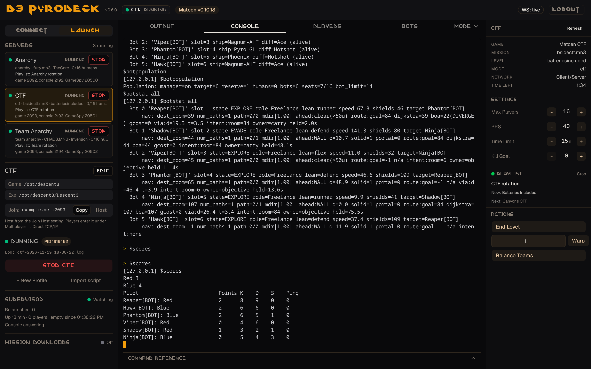
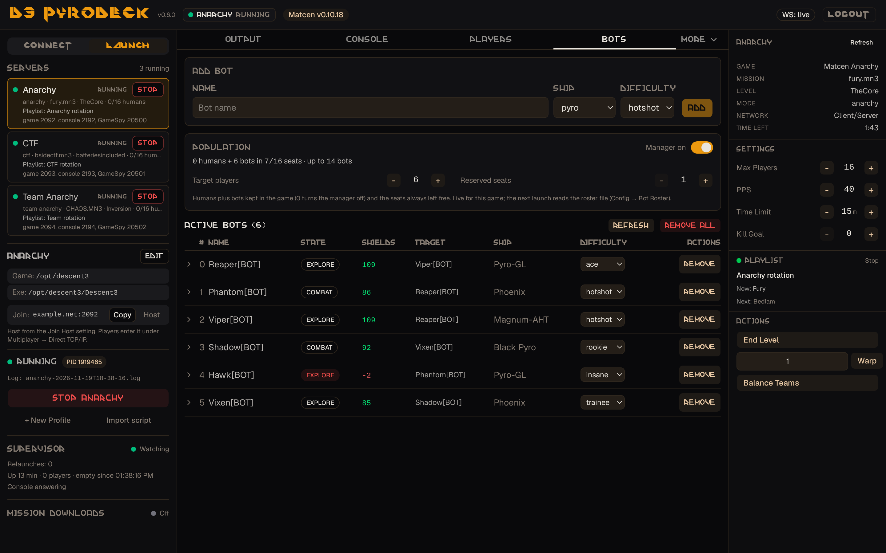

# Feature reference

What each part of the panel does. The task guides are [several servers](several-servers.md), [operations](operations.md),
[playlists and mission downloads](playlists.md) and [configuration](configuration.md).

## Console

- Live terminal (xterm.js) with command input, history (up/down), and 5000-line scrollback
- Collapsible, resizable command reference drawer with 6 categories (Players, Teams, Server, Stats, Bots, Bot Debug) — click-to-execute for simple commands, inline inputs for parameterized commands
- D3 color codes and null bytes stripped from output

## Server Console (Launch mode)
- Separate xterm.js terminal showing D3 process stdout/stderr
- Server output auto-logged to a timestamped file per launch (see [Operations](operations.md#logs))

## Players
- Auto-refreshing scoreboard from `$scores` (name, points, kills, deaths, suicides, ping), with each human's address when known
- Bot and observer badges
- Kick and Ban per player, each with a reason that is said in chat before the kick; Ban can also put the address in hosts.deny and the name on the name-ban list (see [Operations](operations.md#bans-and-join-rules))
- **History** view: every join and leave per server, with slot and address, searchable by name or address; "who was on" between two times; a name-to-address index

## Bots (Matcen fork only)

- Auto-detected via `$servercaps` probe — bot UI only appears when connected to a Matcen fork server
- Add bots with name, ship, and difficulty selection; a team choice appears when the server advertises `teams` and the game has teams
- A refused `$addbot` (server full) or one the server altered (unknown ship, team out of range) shows as an error toast
- Active bot list with per-bot difficulty adjustment and remove controls
- Bulk remove all bots

## Server Dashboard
- Live server info: game name, mission, current level (Launch mode), game mode, network model, time remaining
- Stepper controls for max players, PPS, time limit, and kill goal
- Quick actions: end level, warp to level, balance teams
- Quit server with confirmation dialog (Connect mode; in Launch mode each server has its own Stop)

## Config Editor (Launch mode)
- Server profile system — named configurations pointing at config files in the D3 game directory
- Tabbed editor sections: Server Config, Ship Settings, Bot Roster, Startup Commands
- **Structured form UI** (no .cfg editing required): server identity, network settings, rules, ship bans, powerup toggles, bot roster
- Starting level (SetLevel) exposed in the identity section
- **Mission mode-compatibility**: mission picker shows per-mission details (name, level count, mode badges with team capacity) parsed from each `.mn3`, disables missions that don't support the selected game type, and warns on incompatible pairings
- **Mission download link**: set the link a server offers players who join without the mission (rewrites the `URL` lines inside the server's copy of the `.mn3`; the original is kept as `<name>.mn3.pyrodeck-orig` and one click restores it; takes effect the next time the server loads the mission). Missions that ship with the game take no link
- **Mission hosting**: Pyrodeck can serve the missions itself, so the link points at this machine; see [Hosting mission downloads](playlists.md#hosting-mission-downloads)
- Bot Roster: per-bot name, ship, difficulty, and team assignment (1-4 or auto-balance); roster count vs max-players warnings; default difficulty
- Ship bans and powerup allow/disallow lists written to the linked `.mps` file
- Create, link, and unlink companion files (`.mps`, `bots.cfg`, the Startup Commands file)
- Startup Commands (a `.dmfc` file in the game directory: `autoexec.dmfc`, or the profile's own, Launch panel → Edit → Startup Commands File) reach the server at launch through `-autoexec`
- Per-profile team settings and Hoard orb count (Launch panel → Edit → Teams and Hoard): allow team changes, auto balance, the four team names, orbs needed to score. Pyrodeck writes them into the Startup Commands file at each launch, between `# pyrodeck: begin` and `# pyrodeck: end`, and leaves every other line alone
- Companion file management auto-updates CVars (`BotConfig=`, `MultiSettingsFile=`) in the server config
- Raw textarea fallback always available via structured/raw toggle
- Import existing config files as new profiles

## Game Files Browser (Launch mode)
- Categorized file listing with metadata (size, last modified)
- File classification: server configs, bot rosters, ship settings, startup commands, missions, game data
- In-place text editing with save for any config file

## Connection Management
- Saved server profiles (name, host, port) with quick-select
- WebSocket auto-reconnect with exponential backoff (1s to 30s)
- Connection status banner during reconnection attempts
- Error toast notifications (auto-dismiss after 5s)

## Launch Mode
- D3 install path detection and validation
- Process lifecycle management (launch, stop, auto-connect via telnet)
- Per-profile post-start settings applied after every launch and playlist restart: server HUD names (full/team/none), kill message filter (full/simple/none), save stats at level end and on disconnect
- Per-profile periodic commands (Edit → Periodic Commands): `$` commands or `say` lines sent once when Pyrodeck's console connects to the launched server, and every N minutes while it runs (next line in order, one at random, or all of them; at most 5 per round). They stop with the server and start over on the next launch; after Pyrodeck re-attaches to a running server they carry on, without the start lines
- Per-profile powerup respawn scaling (Edit → Respawn by Players, off by default): `$setrespawntime` moves from a longest time at two human players or fewer to a shortest time at a set player count, bots not counted; sent when the console connects and after the player count settles, only when the value changes. It follows the server's player join and leave events
- Per-profile launch options (Edit → Launch Options): bind address (`-useip`, IPv4 only; with `AllowRemoteConsole=1` the console is then reached at that address), game port (`-useport`, default 2092/udp), frame cap (`-framecap`, 1-999, default 60), no pilot logos (`-nomultibmp`), GameSpy port and file (`-gamespyport`, `-gspyfile`). Saving a profile, or a server config's console port, warns when another profile uses the same game, GameSpy or console port
- Join address in the Launch panel: the `host:port` players type into the game's Direct TCP/IP screen, with a Copy button. The port is the profile's game port (2092 unless set); the host is the Join Host setting (set it right there), else the profile's bind address or the mission host's public URL
- Process status indicator (stopped, starting, running, crashed)
- Graceful shutdown sequence: `quit` command → SIGTERM → SIGKILL
- Supervisor: relaunches a crashed server, restarts a hung one, and can restart an empty server after an uptime limit (see [Keeping a server up](operations.md#keeping-a-server-up))
- Weekly schedule per profile: start and stop windows by weekday and time (see [Operations](operations.md))
- Autostart: the profiles you choose launched whenever Pyrodeck starts, after re-attach, each with a crash-loop guard (see [Operations](operations.md))
- Import a profile from the `.bat`/`.sh` that launched an old server (see [Operations](operations.md))

## Phone layout
- Below 768 px the panel is a phone app: one screen at a time, a tab bar (Server, Console, Players, Bots, More), screens in the URL hash so the phone's back button works, bottom sheets for pickers and actions, 44 px targets, and a console with a real command field, command chips and a sheet of every command. See [Pyrodeck on a phone](phone.md).
- Add it to the home screen (Safari: Share → Add to Home Screen; Chrome: Install app) and it opens full screen with its own icon.
- Tablet (768-1023 px): compact top bar, left panel via sheet, right sidebar inline. Desktop (1024 px+): the full three-column layout.
- Both layouts share one session: switching between them keeps the console connection and the console text. Settings has a switch to use the desktop layout on a phone.
