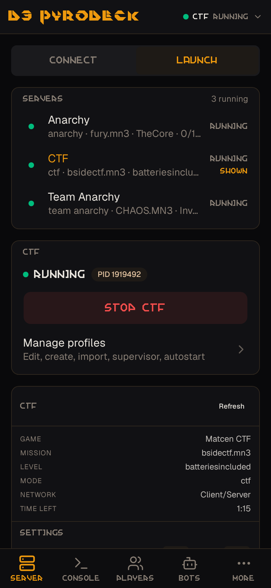
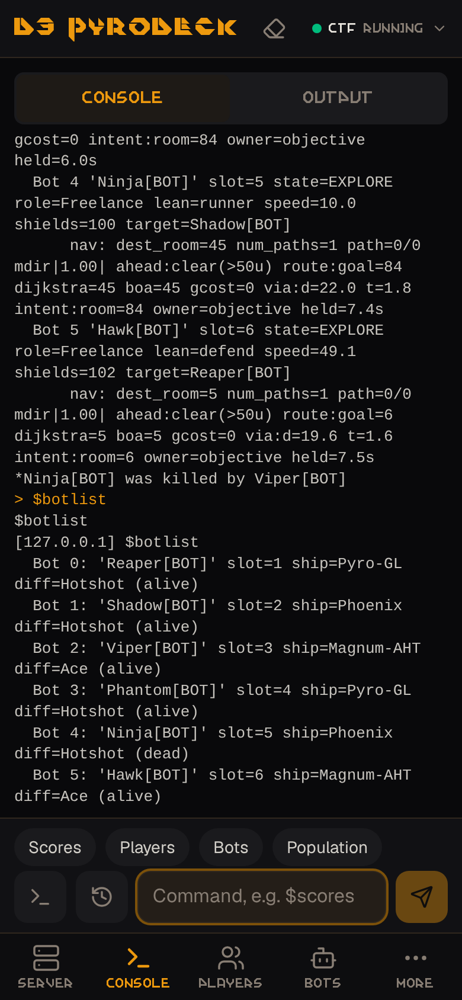
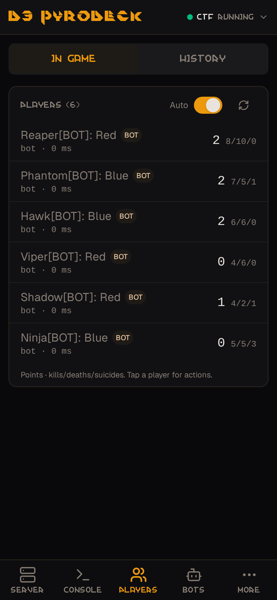
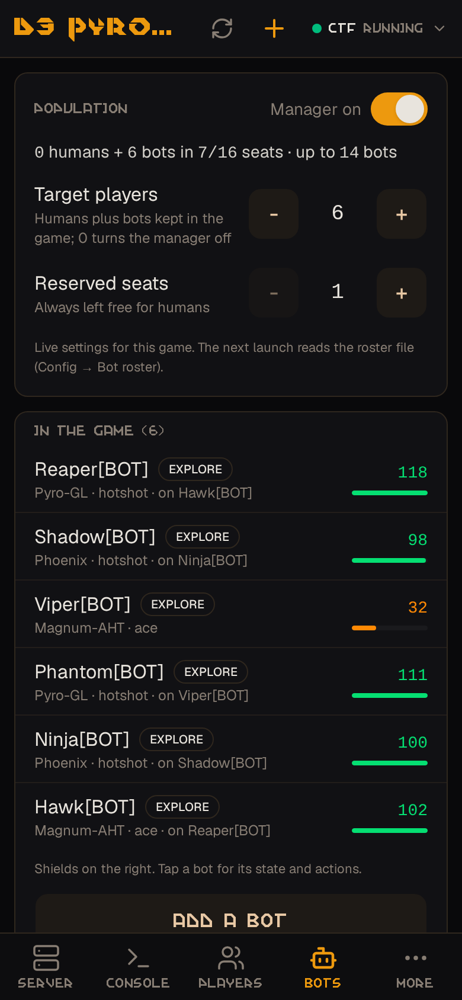

# Pyrodeck on a phone

Below 768 px wide the panel shows its phone layout: one screen at a time and a tab bar along the bottom. Nothing is
separate to install; the same address serves both layouts, and the phone layout talks to the same server over the
same login.

## Add it to the home screen

The panel is a web app with a manifest and icons, so a phone can open it like an app: full screen, its own icon, no
browser bars.

- **iPhone (Safari):** open the panel, tap Share, then **Add to Home Screen**.
- **Android (Chrome):** open the panel, tap the menu, then **Install app** or **Add to Home screen**.

The home-screen app keeps its login like the browser does. If the panel sits behind a reverse proxy, the manifest and
icons are served from the same place as the page (`/manifest.webmanifest`, `/icons/`), so a proxy that passes the
whole site through needs nothing extra.

## The server on screen

Pyrodeck can run several servers at once, and every screen is about one of them: the server on screen. Its name and
state sit in the top right of every screen; tap them for a sheet with every server, its state, game type, mission
and players, and tap a server to show it instead. The Server tab lists the same servers. A console, a roster or a
bot list always belongs to the server named at the top: switching shows that server's own console text and players,
never the last one's.

The server on screen is part of the address (`#/console?s=<id>`), so a reload or a home-screen app opens it again,
and the phone remembers it like the desktop does.

## The tabs

  
  
  
  

- **Server.** Connect or Launch at the top. In Launch mode: every server with its state and how many run (tap one to
  show it), then the server on screen with its state and one button to launch or stop it (stopping asks first and
  leaves the other servers running; a launch Pyrodeck refuses says why, naming the server it would clash with), and,
  once its console is up, the live server card: game, mission, level, time left, Max Players, PPS, time limit and
  kill goal steppers, the playlist, End Level, Warp and Balance Teams. In Connect mode: saved servers and the connect
  form, then the same card. *Manage profiles* opens the full Launch panel: edit, create or import a profile, the
  schedule, autostart, the supervisor and mission downloads.
- **Console.** The telnet console as scrolling text with a command field under it: type, or tap a chip (Scores,
  Players, Bots, Population), or open the full list of commands by group. Recent commands sit behind the clock button
  for the browser session. In Launch mode a switch shows the game's own output instead. The eraser clears the view.
- **Players.** The scoreboard, one row per player; tap a player to kick or ban, with the reason the way the desktop
  asks for it. *History* is the join and leave record.
- **Bots.** On a Matcen server: the population manager (on or off, target players, reserved seats, who is in the
  game), the bots with their shields and state, a tap for one bot's details, difficulty and removal, and the add-bot
  sheet. *Startup roster* leads to the roster file the next launch reads.
- **More.** Profiles, Config (the server config as a form or raw text, the bot roster, the profile's startup
  commands, ship settings, every config file in the game directory), Playlists (shared by all servers; activating
  one starts it on the server on screen, and each playlist says where it is active), Logs, Bans, Rules, Settings,
  log out. Bans and Settings apply to all servers.

The phone's back button and a swipe back work on stacked screens; each tab's own screen is a root, so back from
there leaves the panel like it leaves any app.

## Getting the desktop layout on a phone

Settings has a switch, *Use the desktop layout on this phone*. The desktop Settings tab shows the same switch while
the screen is this narrow, which is the way back. The choice is kept per browser.

## What stays the same

Both layouts share one session: switching between them, or rotating a tablet across the 768 px line, keeps the
console connection, the server on screen and the console text. Each server's console text is kept while you move
between screens and servers, up to the last 2000 console lines and 5000 lines of game output per server.
